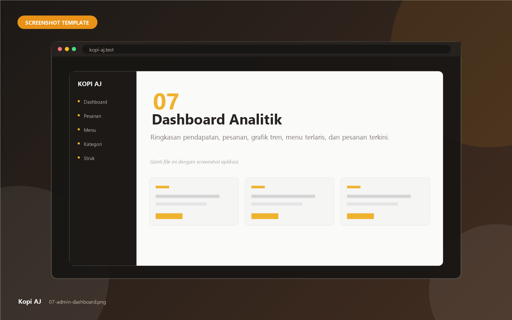
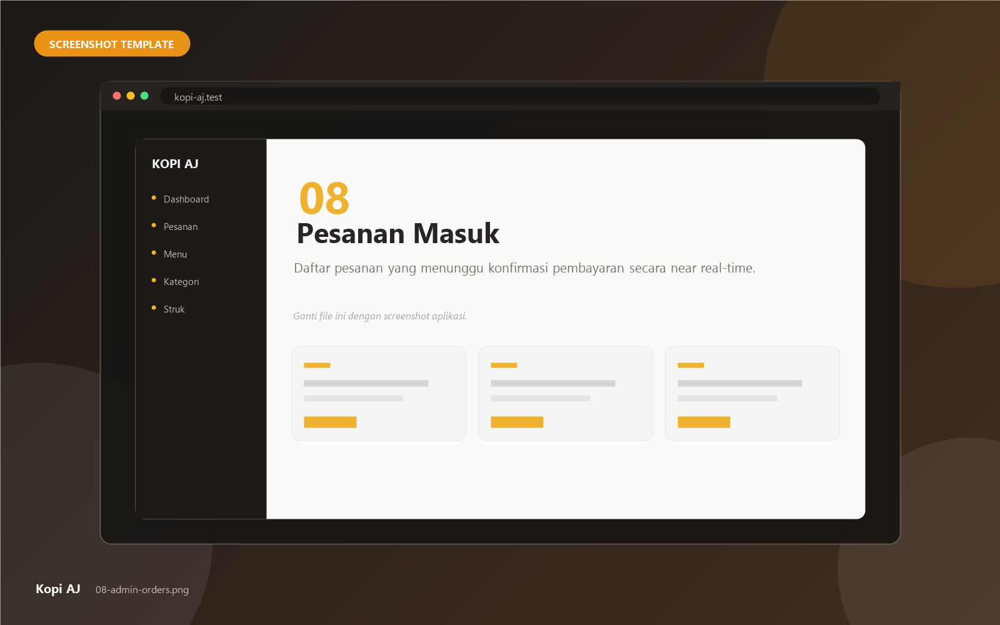
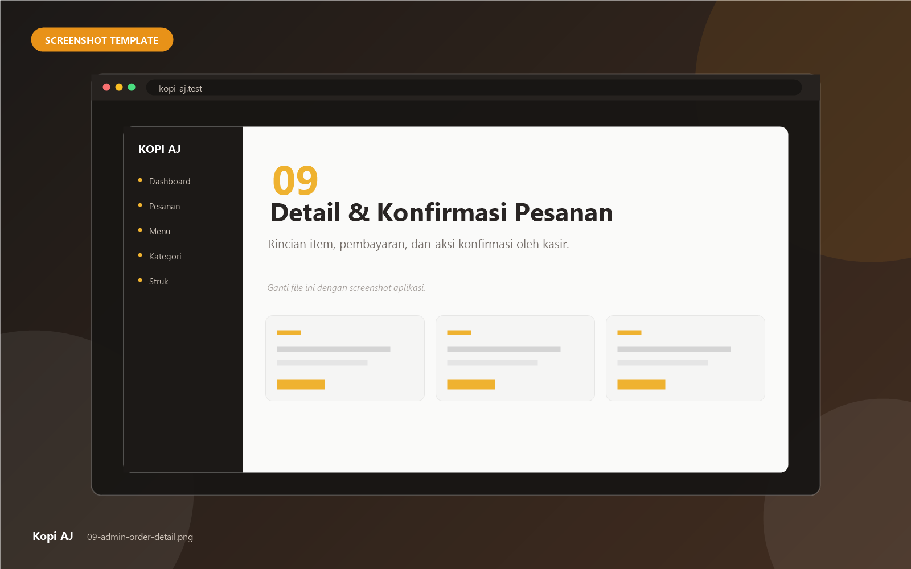
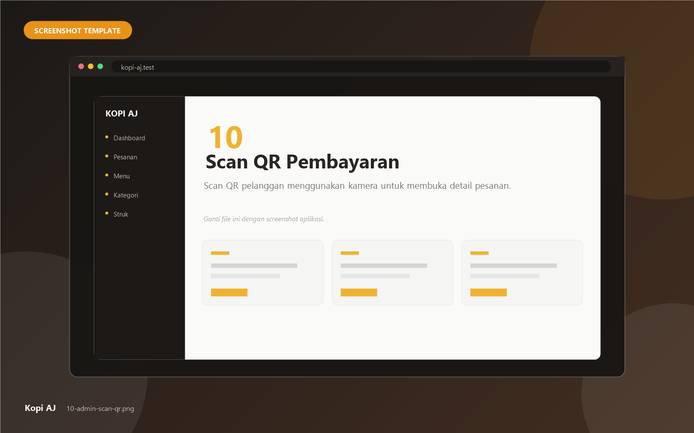
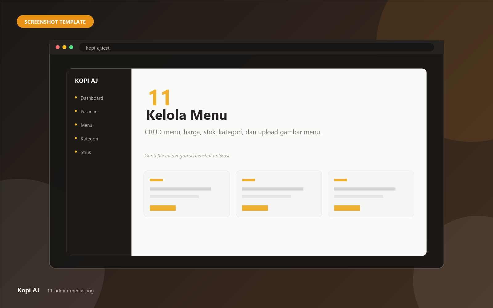
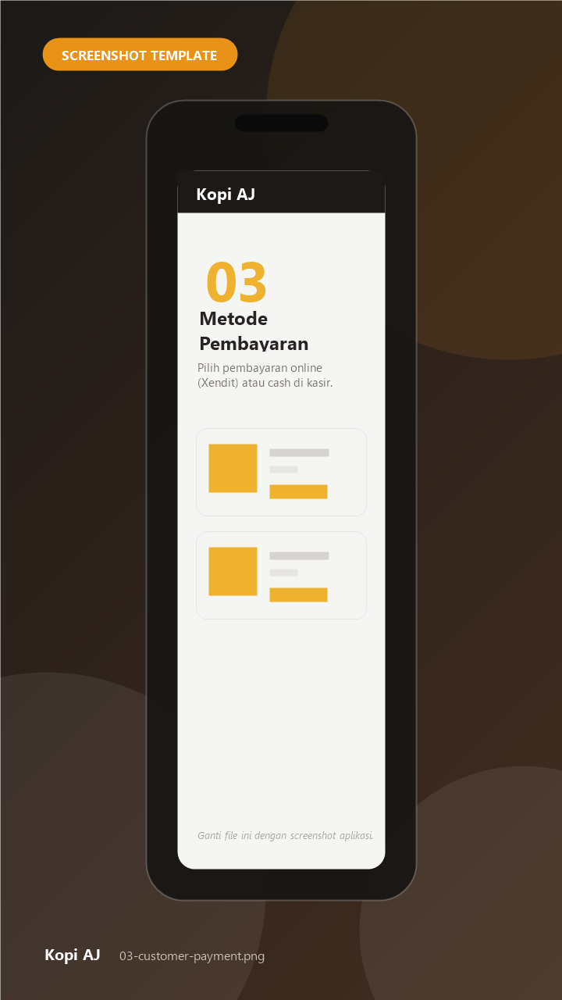
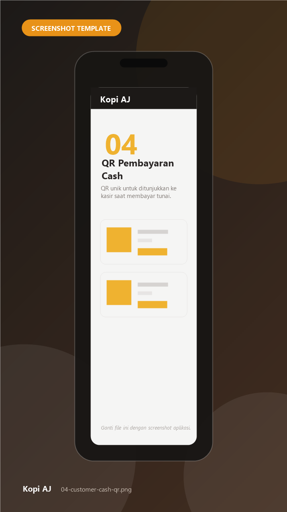
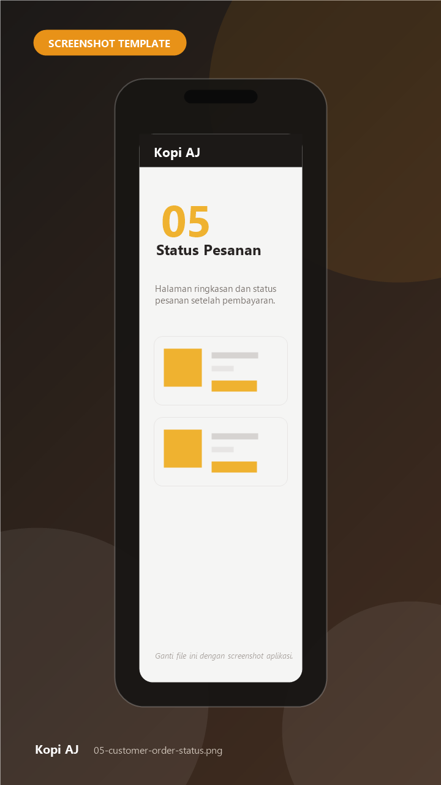
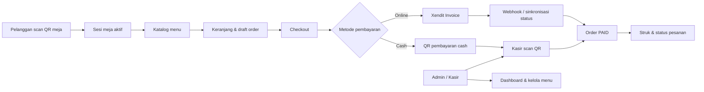

<div align="center">

# ☕ Kopi AJ

### Self-order QR menu & POS untuk kafe dan restoran

Pelanggan scan QR meja, pilih menu, bayar online atau tunai, lalu kasir mengonfirmasi lewat scan QR — semuanya dalam satu alur yang rapi.

[](https://laravel.com)
[](https://www.php.net)
[](https://tailwindcss.com)
[](https://alpinejs.dev)
[](https://www.mysql.com)
[](https://opensource.org/licenses/MIT)

[Fitur](#-fitur-utama) · [Tech Stack](#-tech-stack--alat) · [Screenshot](#-tampilan-aplikasi) · [Instalasi](#-panduan-instalasi) · [Struktur Proyek](#-struktur-proyek) · [Kontribusi](#-kontribusi)

</div>

---

<p align="center">
  
</p>

> [!NOTE]
> Gambar di atas masih **template screenshot**. Ganti placeholder di folder [`docs/screenshots`](docs/screenshots/README.md) dengan screenshot asli aplikasi. Nama file sudah disiapkan, jadi README akan otomatis menampilkan gambar baru tanpa perlu diedit.

---

## 📖 Tentang Proyek

**Kopi AJ** adalah aplikasi pemesanan mandiri (*self-order*) berbasis web untuk kafe, restoran, atau kedai kopi. Setiap meja memiliki QR code sendiri. Pelanggan cukup memindai QR, memilih menu, mengatur jumlah pesanan, lalu membayar secara online melalui **Xendit** atau tunai di kasir.

Di sisi belakang, kasir mendapatkan notifikasi pesanan baru, memverifikasi pembayaran dengan memindai QR pelanggan, mencetak struk, dan memantau performa penjualan melalui dashboard analitik.

Aplikasi dibuat dengan **Laravel 12**, **Tailwind CSS 4**, dan **Alpine.js**, sehingga ringan, responsif, dan mudah dikembangkan.

---

## ✨ Fitur Utama

### 📱 Pengalaman Pelanggan

| Fitur | Deskripsi |
| --- | --- |
| **Scan QR per meja** | Setiap meja punya QR unik. Scan akan membuat sesi meja baru, menonaktifkan sesi lama, dan mereset keranjang agar tidak tercampur antar pelanggan. |
| **Katalog menu interaktif** | Menu dikelompokkan per kategori, dilengkapi pencarian, gambar, harga, deskripsi, dan hanya menampilkan menu yang stoknya tersedia. |
| **Keranjang realtime** | Tambah, kurangi, dan hapus item tanpa reload. Badge jumlah item, subtotal, dan total langsung diperbarui melalui AJAX. |
| **Catatan pesanan** | Pelanggan bisa menambahkan catatan khusus, misalnya tingkat kepedasan atau permintaan tanpa bahan tertentu. |
| **Rincian pembayaran otomatis** | Subtotal, PB1 10%, biaya lain, dan pembulatan ke kelipatan Rp500 dihitung otomatis. |
| **Pembayaran online** | Integrasi **Xendit Invoice** untuk QRIS, e-wallet, virtual account, dan channel pembayaran lain. |
| **Pembayaran tunai** | Pelanggan mendapatkan QR unik untuk ditunjukkan dan dipindai oleh kasir. |
| **Status pembayaran near real-time** | Halaman status melakukan polling untuk pembayaran cash dan sinkronisasi status invoice Xendit saat halaman dibuka. |
| **Ringkasan pesanan** | Halaman status pesanan menampilkan item, total, metode pembayaran, dan status akhir. |
| **Profil meja** | Menampilkan informasi meja dan sesi yang sedang aktif. |

### 🧑‍💼 Panel Admin & Kasir

| Fitur | Deskripsi |
| --- | --- |
| **Login berbasis role** | Mendukung role `admin`, `cashier`, dan `customer` dengan middleware role. |
| **Dashboard analitik** | Filter periode (hari ini, kemarin, minggu ini, bulan ini, tahun ini, custom), kartu pendapatan, total pesanan, pesanan menunggu, dan jumlah menu. |
| **Grafik penjualan** | Tren pendapatan dan jumlah pesanan menggunakan **Chart.js**, plus donut chart distribusi metode pembayaran. |
| **Menu terlaris** | Top 5 menu berdasarkan kuantitas terjual dan kontribusi pendapatan pada periode terpilih. |
| **Pesanan terkini** | Daftar pesanan terbaru beserta meja, total, metode, dan waktu. |
| **Notifikasi pesanan** | Polling endpoint untuk badge lonceng, dropdown preview, toast, dan suara notifikasi sintetis saat ada pesanan baru. |
| **Pesanan masuk** | Daftar pesanan berstatus `submitted` dengan pembayaran `pending`, siap dikonfirmasi kasir. |
| **Daftar pesanan** | Riwayat pesanan `submitted` dan `paid` dalam satu tabel. |
| **Scan QR pembayaran** | Memindai QR pelanggan dengan kamera menggunakan `html5-qrcode`, atau memasukkan token secara manual. |
| **Konfirmasi pembayaran** | Mengubah status payment menjadi `paid` dan order menjadi `paid` dalam satu transaksi database. |
| **Struk pembayaran** | Halaman struk siap cetak dengan rincian item, pajak, pembulatan, dan total. |
| **Kelola menu** | CRUD menu, pencarian, filter kategori, harga, stok, deskripsi, dan upload gambar ke storage. |
| **Daftar kategori** | Halaman kategori untuk melihat dan mengelola pengelompokan menu. |
| **Dark mode** | Tampilan admin mendukung mode terang dan gelap. |

### 🔌 Integrasi & Fitur Teknis

- **Xendit Invoice API** — pembuatan invoice, pengecekan status invoice, dan sinkronisasi pembayaran.
- **Webhook Xendit** — endpoint `POST /api/webhooks/xendit` dengan validasi `x-callback-token`.
- **Simple QrCode** — generasi QR pembayaran cash langsung dari server.
- **Table session middleware** — memastikan pelanggan hanya bisa memesan selama sesi meja aktif.
- **Order draft middleware** — membuat atau mengambil draft order otomatis untuk setiap sesi meja.
- **Price calculator terpusat** — perhitungan PB1 dan pembulatan konsisten di seluruh alur.
- **Enum status** — status order dan payment yang type-safe.
- **Service layer** — logika pembayaran, menu, harga, dan integrasi pihak ketiga dipisahkan dari controller.
- **Fonnte service** — service notifikasi WhatsApp opsional dengan token yang dibaca dari environment.

---

## 🧰 Tech Stack & Alat

### Backend

| Teknologi | Kegunaan |
| --- | --- |
| **PHP 8.2+** | Bahasa pemrograman utama. |
| **Laravel 12** | Framework aplikasi, routing, Eloquent ORM, validasi, session, queue, dan Blade. |
| **MySQL / MariaDB** | Database utama. |
| **Laravel HTTP Client** | Komunikasi dengan API Xendit dan Fonnte. |
| **Laravel Queue & Scheduler** | Antrean job dan tugas terjadwal (siap dikembangkan). |

### Frontend

| Teknologi | Kegunaan |
| --- | --- |
| **Blade** | Template engine server-side. |
| **Tailwind CSS 4** | Styling responsif dan utility-first. |
| **Alpine.js 3** | Interaksi ringan di sisi klien (dropdown, accordion, modal). |
| **Vite 7** | Build tool dan dev server dengan hot reload. |
| **Remixicon** | Ikon antarmuka. |
| **Chart.js** | Grafik dashboard. |
| **html5-qrcode** | Pemindaian QR melalui kamera browser. |
| **Material Dashboard** | Aset tampilan halaman login admin. |

### Integrasi & Layanan

| Layanan | Kegunaan |
| --- | --- |
| **Xendit** | Payment gateway untuk pembayaran online (QRIS, e-wallet, VA, dan lainnya). |
| **Simple QrCode** | Pembuatan QR code pembayaran cash. |
| **Fonnte** | Integrasi WhatsApp opsional untuk notifikasi. |

### Alat Pengembangan

| Alat | Kegunaan |
| --- | --- |
| **Composer** | Manajemen dependency PHP. |
| **npm** | Manajemen dependency frontend. |
| **Laravel Pint** | Formatter kode PHP. |
| **PHPUnit** | Testing. |
| **Laravel Pail** | Melihat log aplikasi secara real-time. |
| **Laravel Sail** | Environment pengembangan berbasis Docker (opsional). |
| **Git & GitHub** | Version control dan kolaborasi. |
| **Laragon / XAMPP** | Web server lokal untuk Windows. |
| **ngrok** | Tunnel publik untuk menguji webhook Xendit di lokal. |

---

## 📸 Tampilan Aplikasi

> [!TIP]
> Semua gambar di bawah adalah **placeholder**. Ganti file di [`docs/screenshots`](docs/screenshots/README.md) dengan nama yang sama untuk menampilkan screenshot asli.

### 🖥️ Panel Admin & Kasir

<table>
  <tr>
    <td width="50%" align="center">
      
      <br><sub><b>Dashboard analitik</b><br>Pendapatan, tren penjualan, menu terlaris, dan pesanan terkini.</sub>
    </td>
    <td width="50%" align="center">
      
      <br><sub><b>Pesanan masuk</b><br>Pesanan yang menunggu konfirmasi pembayaran.</sub>
    </td>
  </tr>
  <tr>
    <td width="50%" align="center">
      
      <br><sub><b>Detail & konfirmasi</b><br>Rincian item dan aksi konfirmasi oleh kasir.</sub>
    </td>
    <td width="50%" align="center">
      
      <br><sub><b>Scan QR pembayaran</b><br>Verifikasi pembayaran pelanggan lewat kamera.</sub>
    </td>
  </tr>
  <tr>
    <td width="50%" align="center">
      
      <br><sub><b>Kelola menu</b><br>CRUD menu, harga, stok, dan gambar.</sub>
    </td>
    <td width="50%" align="center">
      
      <br><sub><b>Struk pembayaran</b><br>Struk siap cetak dengan rincian lengkap.</sub>
    </td>
  </tr>
</table>

### 📱 Tampilan Pelanggan

<p align="center">
  
  
  
  
  
</p>

<p align="center">
  <sub><b>Menu</b> · <b>Keranjang</b> · <b>Pembayaran</b> · <b>QR Cash</b> · <b>Status Pesanan</b></sub>
</p>

### 🔐 Halaman Login

<p align="center">
  
</p>

---

## 🏗️ Arsitektur & Alur



**Alur singkat:**

1. Pelanggan memindai QR meja dan diarahkan ke `/scan/{table_number}`.
2. Sistem membuat `table_session` baru dan draft order.
3. Pelanggan memilih menu; item disimpan ke `order_items` melalui AJAX.
4. Saat checkout, pelanggan mengisi data dan memilih metode pembayaran.
5. Pembayaran online membuat invoice Xendit; pembayaran cash menghasilkan QR unik.
6. Kasir memverifikasi pembayaran melalui scan QR atau menunggu webhook Xendit.
7. Status order berubah menjadi `paid`, lalu pelanggan melihat ringkasan dan kasir dapat mencetak struk.

### 🗄️ Tabel Database Utama

| Tabel | Fungsi |
| --- | --- |
| `users` | Pengguna dengan role `admin`, `cashier`, atau `customer`. |
| `tables` | Data meja, nomor meja, token QR, dan status aktif. |
| `table_sessions` | Sesi pelanggan per meja; hanya satu sesi aktif per meja. |
| `categories` | Kategori menu. |
| `menus` | Menu, harga, stok, deskripsi, dan gambar. |
| `orders` | Pesanan, nomor order, subtotal, PB1, service charge, pembulatan, total, dan status. |
| `order_items` | Detail item pesanan beserta harga saat transaksi. |
| `payments` | Pembayaran, metode, provider, referensi Xendit, QR token, status, dan payload. |
| `sessions`, `cache`, `jobs` | Tabel bawaan Laravel untuk session, cache, dan queue. |

---

## 🚀 Panduan Instalasi

### Prasyarat

Pastikan perangkat kamu sudah memiliki:

- **PHP 8.2+** dengan ekstensi `pdo_mysql`, `mbstring`, `openssl`, `fileinfo`, `curl`, dan `gd`.
- **Composer 2**
- **Node.js 20+** dan **npm**
- **MySQL 8** atau **MariaDB 10.4+**
- **Git**

Cek versi:

```bash
php -v
composer -V
node -v
npm -v
mysql --version
```

### 1. Clone Repository

```bash
git clone https://github.com/awaludin16/kopi-aj.git
cd kopi-aj
```

### 2. Install Dependency

```bash
composer install
npm install
```

### 3. Siapkan Environment

```bash
cp .env.example .env
php artisan key:generate
```

> Pengguna Windows bisa menggunakan `copy .env.example .env` di Command Prompt.

### 4. Buat Database

Buat database baru bernama `kopi_aj`:

```sql
CREATE DATABASE kopi_aj CHARACTER SET utf8mb4 COLLATE utf8mb4_unicode_ci;
```

Sesuaikan konfigurasi database di `.env`:

```env
DB_CONNECTION=mysql
DB_HOST=127.0.0.1
DB_PORT=3306
DB_DATABASE=kopi_aj
DB_USERNAME=root
DB_PASSWORD=
```

### 5. Migrasi & Seed Data

```bash
php artisan migrate --seed
```

Perintah ini akan membuat seluruh tabel dan mengisi data contoh: kategori, menu, meja, sesi meja, serta akun admin dan kasir.

### 6. Buat Storage Link

```bash
php artisan storage:link
```

Diperlukan agar gambar menu yang diunggah dapat diakses publik.

### 7. Build Frontend

Untuk produksi:

```bash
npm run build
```

Untuk pengembangan dengan hot reload:

```bash
npm run dev
```

### 8. Jalankan Aplikasi

```bash
php artisan serve
```

Buka:

- **Pelanggan:** `http://localhost:8000/scan/1`
- **Admin / Kasir:** `http://localhost:8000/admin/auth`
- **Root:** `http://localhost:8000` akan diarahkan ke meja aktif secara acak.

Alternatif, jalankan server, queue, dan Vite sekaligus:

```bash
composer run dev
```

> Jika memakai cara ini, `php artisan serve` dan `npm run dev` tidak perlu dijalankan terpisah.

### ⚡ Shortcut Setup

Tersedia script setup otomatis:

```bash
composer run setup
php artisan db:seed
php artisan storage:link
```

Script `composer run setup` menjalankan `composer install`, menyalin `.env`, generate key, migrasi, `npm install`, dan `npm run build`. Database tetap harus dibuat terlebih dahulu.

---

## 🔑 Akun Demo

Setelah `php artisan migrate --seed`, gunakan akun berikut:

| Role | Email | Password |
| --- | --- | --- |
| Admin | `admin@example.com` | `password` |
| Kasir | `cashier@example.com` | `password` |

> [!IMPORTANT]
> Segera ganti password akun demo sebelum aplikasi digunakan di lingkungan nyata.

---

## ⚙️ Konfigurasi Environment

| Variabel | Keterangan | Contoh |
| --- | --- | --- |
| `APP_NAME` | Nama aplikasi. | `"Kopi AJ"` |
| `APP_URL` | URL utama aplikasi. | `http://localhost:8000` |
| `APP_TIMEZONE` | Zona waktu aplikasi. | `Asia/Jakarta` |
| `APP_LOCALE` | Bahasa aplikasi. | `id` |
| `DB_CONNECTION` | Driver database. | `mysql` |
| `DB_DATABASE` | Nama database. | `kopi_aj` |
| `DB_USERNAME` | Username database. | `root` |
| `DB_PASSWORD` | Password database. | *(kosong)* |
| `SESSION_DRIVER` | Driver session. | `database` |
| `QUEUE_CONNECTION` | Driver queue. | `database` |
| `XENDIT_SECRET_KEY` | Secret key API Xendit. | `xnd_development_...` |
| `XENDIT_CALLBACK_TOKEN` | Token verifikasi webhook Xendit. | `random-token` |
| `XENDIT_BASE_URL` | Base URL API Xendit. | `https://api.xendit.co` |
| `FONNTE_TOKEN` | Token API Fonnte (opsional). | `xxxxx` |

### 💳 Konfigurasi Xendit

1. Buat akun di [Xendit](https://www.xendit.co/) dan buka dashboard.
2. Salin **Secret Key** ke `XENDIT_SECRET_KEY`.
3. Tentukan **Callback Token** dan isi `XENDIT_CALLBACK_TOKEN`.
4. Daftarkan webhook URL:

   ```text
   https://domain-kamu.com/api/webhooks/xendit
   ```

5. Untuk pengujian lokal, buat tunnel dengan ngrok:

   ```bash
   ngrok http 8000
   ```

   Lalu gunakan URL ngrok sebagai basis webhook:

   ```text
   https://xxxx.ngrok-free.app/api/webhooks/xendit
   ```

6. Pastikan metode HTTP webhook adalah **POST** dan header `x-callback-token` sesuai dengan nilai di `.env`.

> Jika Xendit belum dikonfigurasi, pembayaran online tidak akan berfungsi. Pembayaran cash tetap dapat digunakan.

---

## 🧭 Route Penting

| Method | Route | Keterangan |
| --- | --- | --- |
| `GET` | `/` | Redirect ke meja aktif secara acak. |
| `GET` | `/scan/{table_number}` | Entry point pelanggan setelah scan QR meja. |
| `GET` | `/menu` | Katalog menu pelanggan. |
| `GET` | `/order` | Keranjang dan checkout. |
| `GET` | `/payment` | Halaman pemilihan metode pembayaran. |
| `GET` | `/payment/cash/{qrToken}` | QR pembayaran cash. |
| `GET` | `/order/summary` | Status dan ringkasan pesanan. |
| `GET` | `/admin/auth` | Halaman login admin/kasir. |
| `GET` | `/admin/dashboard` | Dashboard analitik. |
| `GET` | `/admin/orders` | Pesanan masuk. |
| `GET` | `/admin/scan` | Scan QR pembayaran. |
| `GET` | `/admin/menus` | Kelola menu. |
| `POST` | `/api/webhooks/xendit` | Webhook pembayaran Xendit. |

---

## 📁 Struktur Proyek

```text
kopi-aj/
├── app/
│   ├── Enums/                     # Status order & payment
│   ├── Http/
│   │   ├── Controllers/
│   │   │   ├── Admin/             # Dashboard, menu, order, kategori
│   │   │   ├── Auth/              # Login & logout
│   │   │   ├── Customer/          # Menu, cart, order, payment, scan
│   │   │   └── Webhook/           # Webhook Xendit
│   │   ├── Middleware/            # Session meja, draft order, role
│   │   └── Requests/              # Form request validation
│   ├── Models/                    # Eloquent models
│   └── Services/                  # Price, menu, Xendit, Fonnte
├── database/
│   ├── migrations/                # Skema database
│   └── seeders/                   # Data contoh
├── docs/
│   └── screenshots/               # Template & screenshot aplikasi
├── public/
│   ├── assets/                    # Aset Material Dashboard
│   └── storage/                   # Symlink storage publik
├── resources/
│   ├── css/                       # Tailwind & tema
│   ├── js/                        # Alpine, cart, order, payment
│   └── views/
│       ├── admin/                 # Halaman admin
│       ├── auth/                  # Login
│       ├── customer/              # Halaman pelanggan
│       ├── components/            # Komponen Blade
│       └── layouts/               # Layout utama
├── routes/
│   ├── web.php                    # Route web
│   └── api.php                    # Route webhook
├── .env.example
├── composer.json
├── package.json
└── vite.config.js
```

---

## 🛠️ Perintah Berguna

| Perintah | Fungsi |
| --- | --- |
| `php artisan serve` | Menjalankan server lokal. |
| `npm run dev` | Menjalankan Vite dengan hot reload. |
| `npm run build` | Build aset untuk produksi. |
| `php artisan migrate` | Menjalankan migrasi. |
| `php artisan migrate:fresh --seed` | Reset database dan isi ulang data contoh. |
| `php artisan db:seed` | Menjalankan seeder. |
| `php artisan storage:link` | Membuat symlink storage. |
| `php artisan queue:work` | Menjalankan worker queue. |
| `php artisan pail` | Melihat log secara real-time. |
| `php artisan test` | Menjalankan test. |
| `./vendor/bin/pint` | Merapikan format kode PHP. |

---

## 🔒 Keamanan

- File `.env` **tidak** ikut di-commit dan sudah masuk `.gitignore`.
- Token Xendit, Fonnte, dan kredensial database dibaca dari environment.
- Webhook Xendit diverifikasi menggunakan header `x-callback-token`.
- Route admin dilindungi middleware `auth` dan `roles`.
- Sesi meja diverifikasi di setiap request pelanggan.
- Gunakan **HTTPS** saat deploy ke produksi.
- Ganti akun demo dan gunakan password yang kuat.
- Jangan pernah membagikan `APP_KEY`, secret key, atau token di issue publik.

Jika menemukan celah keamanan, laporkan secara privat melalui fitur **Security Advisory** di repository GitHub.

---

## 🗺️ Roadmap

- [x] Self-order via QR meja
- [x] Keranjang realtime dan checkout
- [x] Pembayaran online Xendit
- [x] Pembayaran cash dengan QR
- [x] Dashboard analitik dan grafik
- [x] Notifikasi pesanan near real-time
- [x] Scan QR pembayaran oleh kasir
- [x] CRUD menu dan upload gambar
- [x] Struk siap cetak
- [ ] CRUD kategori lengkap
- [ ] Manajemen meja dan generator QR meja
- [ ] Manajemen user dan hak akses lanjutan
- [ ] Laporan penjualan dengan export Excel/PDF
- [ ] Notifikasi WhatsApp otomatis via Fonnte
- [ ] PWA untuk pengalaman mobile yang lebih baik
- [ ] Dukungan multi-outlet
- [ ] Test coverage yang lebih lengkap

---

## 🤝 Kontribusi

Kontribusi sangat terbuka! Langkahnya:

1. Fork repository ini.
2. Buat branch fitur:

   ```bash
   git checkout -b feat/nama-fitur
   ```

3. Commit perubahan dengan pesan yang jelas:

   ```bash
   git commit -m "feat: tambah fitur ..."
   ```

4. Push ke branch kamu:

   ```bash
   git push origin feat/nama-fitur
   ```

5. Buat **Pull Request** dan jelaskan perubahan yang dilakukan.

Mohon jalankan `./vendor/bin/pint` dan `php artisan test` sebelum mengirim PR.

---

## 📄 Lisensi

Proyek ini menggunakan lisensi **MIT**. Lihat [MIT License](https://opensource.org/licenses/MIT) untuk detailnya.

---

<div align="center">

Dibuat dengan ☕ dan ❤️ untuk Kopi AJ.

**[⬆ Kembali ke atas](#-kopi-aj)**

</div>
